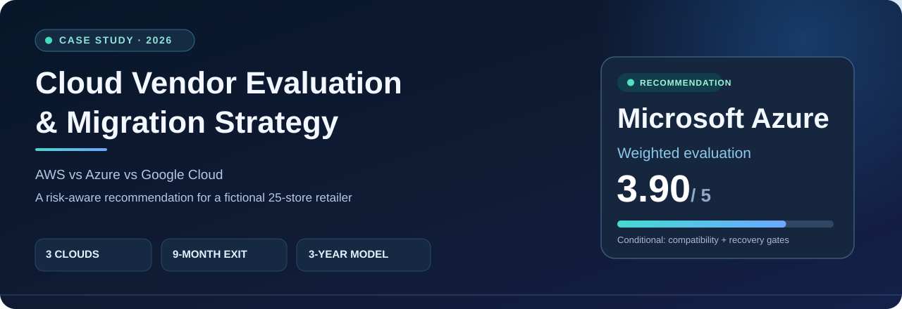
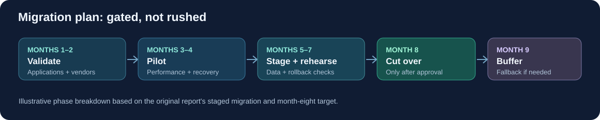

  

  <strong>Cloud strategy · Financial modeling · Security risk · Business continuity</strong> 
  University at Buffalo · MGS 402 · October 2026 · Wafi Ahmed

  <a href="#executive-recommendation">Recommendation</a> ·
  <a href="#the-analysis">Analysis</a> ·
  <a href="#risk--migration-plan">Risk and migration</a> ·
  <a href="#explore-the-deliverables">Deliverables</a> ·
  <a href="#assumptions--scope">Scope</a>

---

> [!NOTE]
> **Academic consulting simulation.** Lakefront Retail is a fictional company. Results are modeled using October 2026 assumptions and do not represent a live deployment, contracted pricing, or realized customer savings.

## The challenge

A fictional regional retailer with **25 stores, roughly 600 employees, and a six-person IT team** must leave its on-premises data center in **nine months**. The business relies on accounting, inventory, shared file services, and reporting, while its IT staff have primarily Microsoft infrastructure experience.

**Decision question:** Which public-cloud provider offers a financially realistic, technically defensible migration path without putting continuity or the lease deadline at risk?

## Executive recommendation

**Select Microsoft Azure for further validation—not immediate unconditional production migration.** In the submitted scenario model, Azure led on three-year TCO and alignment with the existing team's Microsoft expertise. The recommendation remains subject to application, security, storage, and recovery tests.

  

| Evaluation | **Microsoft Azure** | Google Cloud | AWS |
|:--|--:|--:|--:|
| **Modeled three-year TCO** | **$243,741** | $333,382 | $423,343 |
| **Weighted decision score** | **3.90 / 5** | 3.16 / 5 | 2.97 / 5 |
| **Difference vs. Azure** | Baseline | +$89,641 | +$179,602 |
| **Position in scenario** | **Preferred, with conditions** | Viable alternative | Viable alternative |

Modeled estimates include cloud operations, $31K migration/training allowance, and $62.4K internal staff time per option. Configurations differ in storage performance and backup/recovery coverage; the modeled differences are not verified savings.

### Why Azure ranked first

| Decision driver | Weight | Reasoning |
|:--|:--:|:--|
| **Lease deadline feasibility** | **30%** | The data-center exit imposes a nine-month hard constraint. |
| **Three-year economic cost** | **25%** | Multi-year operating and transition costs matter more than the introductory monthly bill. |
| Reliability / SLA | 15% | Retail operations need a realistic continuity and recovery plan. |
| Security / PCI responsibilities | 15% | Cloud adoption does not transfer all security or payment-data obligations. |
| Team skills | 10% | Existing Microsoft experience reduces some transition friction, subject to testing. |
| Exit / vendor lock-in | 5% | Future portability is important, but lower priority than the immediate deadline. |

The decision matrix scored **3.90 for Azure, 3.16 for Google Cloud, and 2.97 for AWS**. Reliability, security, and exit considerations were conservatively tied where the available data did not prove a difference.

**[Review the scoring method and assumptions →](docs/methodology.md)**

## The analysis

Rather than comparing providers on price alone, the project combined financial modeling, operational suitability, security responsibilities, and failure planning.

| Workstream | What I evaluated |
|:--|:--|
| **Cloud economics** | Three-year modeled TCO, cost growth, transition allowances, internal staff time, and exit-cost exposure |
| **Architecture fit** | Windows-based applications, SQL workloads, shared storage, identity, and operational readiness |
| **Service commitments** | Database SLA, eligible credits, submission windows, and limits of financial compensation |
| **Resilience** | RTO/RPO targets, backup cadence mismatch, recovery testing, and continuity planning |
| **Risk management** | Legacy app compatibility, PCI scope, vendor lock-in, timing, and fallback strategies |

### An important financial distinction

The cost ranking was based on the original report's **modeled operating/transition total**, and **excluded contingency and future exit allowances**. For Azure, the report separately outlined a **$217,609 funding allowance** (including an unexpected-expense reserve) and a potential **$39,420 post-year-three exit allowance**. Those figures serve different purposes and should not be added as though they were the same kind of TCO.

**[Explore the financial model →](data/three-year-tco.csv)** · **[Review exit-cost assumptions →](docs/exit-costs.md)**

## Risk & migration plan

The most material risk is not cloud pricing: **legacy inventory or accounting software might require changes or fail during migration**. The recommended approach makes compatibility, security, and recovery validation prerequisites to committing.

  

**Key technical judgment:** The proposed **4-hour RTO** and **1-hour RPO** require verification. A once-daily backup cannot satisfy a one-hour recovery point objective, so improved data protection and restore testing need to be budgeted.

The report also explains why a cloud provider's **SLA service credit is not a substitute for business continuity**: a credit for eligible service charges does not reimburse a retailer for disruption or lost sales.

[Review the risk register](docs/risk-register.md) · [Read the migration gates](docs/migration-plan.md) · [SLA and recovery analysis](docs/sla-and-recovery.md)

## Explore the deliverables

| Asset | What it contains |
|:--|:--|
| 📄 **[Full narrative case study](reports/case-study.md)** | Concise case background, decision process, modeled findings, and caveats |
| 📊 **[Three-year TCO model](data/three-year-tco.csv)** | Cost assumptions and provider breakdowns |
| 🧮 **[Decision matrix](data/decision-matrix.csv)** | Weighted evaluation inputs |
| 🧭 **[Evaluation methodology](docs/methodology.md)** | Scoring rules, economic model, and limitations |
| 🛠 **[Migration strategy](docs/migration-plan.md)** | Milestones, decision gates, operational handover |
| 🛡 **[Risk register](docs/risk-register.md)** | Risks, mitigations, and accountable stakeholders |
| 🔁 **[SLA & disaster recovery](docs/sla-and-recovery.md)** | Availability, credits, RTO/RPO, and backup gaps |
| 🚪 **[Exit-cost analysis](docs/exit-costs.md)** | The separately modeled possible post-year-three exit expense |
| 🧪 **[Model verification script](scripts/verify_model.py)** | Recomputes published scores and TCO totals |

The repository also includes a custom graphical summary and migration timeline derived from the submitted report. The original PDF submission and single-slide presentation are separate supporting files, not required to understand the analysis here.

## Skills demonstrated

**Cloud strategy** · Azure / AWS / Google Cloud comparison · **TCO analysis** · Weighted decision matrices · **Risk and control assessment** · SLA interpretation · RTO/RPO analysis · Migration planning · Executive communication

## Assumptions & scope

- **Fictional client / academic assignment**, not consulting work delivered to a real company.
- **October 2026 pricing snapshot**, not today's prices or guaranteed commercial quotes.
- Compared configurations differ in backup, storage, and recovery performance; vendor costs were **not fully normalized**.
- No live environment was migrated, penetration-tested, or independently audited.
- PCI responsibilities and specific workload compatibility remain open validation items.
- The included verification script was added for portfolio reproducibility and was **not a deliverable of the original report**.

---

  Prepared as an MGS 402 academic consulting project · University at Buffalo · October 2026 
  <strong>Recommendation quality means knowing what could change your recommendation.</strong>

