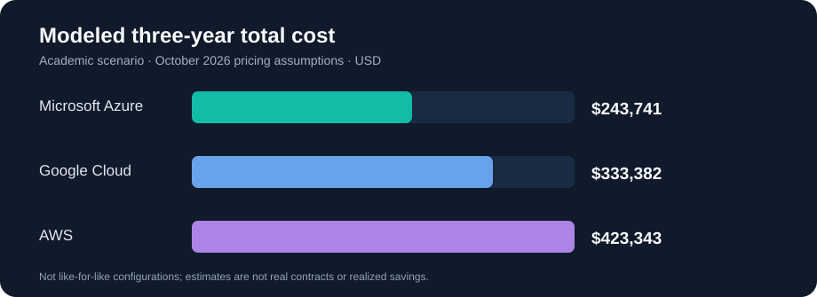

# Cloud Vendor Evaluation & Migration Strategy

**Academic Consulting Case Study | University at Buffalo — MGS 402 | October 2026**

**Project author:** Wafi Ahmed  
**Recommendation:** Microsoft Azure, conditional on application compatibility, recovery testing, and the migration deadline.

> **About this project:** Lakefront Retail is a **fictional company** in an academic case study. All prices are modeled estimates from October 2026—not actual contracts, guaranteed savings, or production deployment results.

## Executive decision

Lakefront Retail is a 25-store regional retailer with approximately 600 employees, a six-person IT team, and a data-center lease ending in nine months. The goal was to identify a practical public-cloud migration path that balanced three-year spending with reliability, security, operational readiness, and the deadline.

I evaluated **Microsoft Azure, Amazon Web Services (AWS), and Google Cloud** using a weighted decision matrix and a three-year total-cost-of-ownership (TCO) model. **Azure ranked first with 3.90/5**, compared with Google Cloud's 3.16/5 and AWS's 2.97/5.

| Provider | Modeled 3-year TCO | Weighted score |
|:--|--:|--:|
| **Microsoft Azure** | **$243,741** | **3.90 / 5** |
| Google Cloud | $333,382 | 3.16 / 5 |
| AWS | $423,343 | 2.97 / 5 |

Compared with the selected alternatives, Azure's modeled total was roughly **$89.6K below Google Cloud** and **$179.6K below AWS**. These are scenario differences, **not savings realized by a real company**; services were not identical in performance and recovery coverage.

## The business problem

- A nine-month data-center lease exit creates schedule and business-continuity risk.
- The IT team already knows Microsoft infrastructure but has limited public-cloud experience.
- Inventory and accounting applications need compatibility testing before migration.
- Store operations depend on reliable systems, data recovery, and clear security responsibilities.
- The CFO needs realistic multi-year costs, not just an introductory monthly cloud price.

## How I made the recommendation

1. **Defined business requirements:** lease deadline, budget, reliability, security/PCI, team skills, and future lock-in.
2. **Built a weighted decision matrix:** deadline (30%), cost (25%), reliability (15%), security (15%), team fit (10%), exit/lock-in (5%).
3. **Modeled three-year TCO:** annual cloud service costs plus a $31K migration/training allowance and $62.4K in internal operations labor for each provider.
4. **Evaluated SLA and recovery limitations:** examined database availability commitments, credits, outage exclusions, and the difference between backup frequency and RPO.
5. **Proposed a gated migration:** validate application compatibility early, stage the transition, aim for a month-eight cutover, and preserve a one-month buffer.

**Key finding:** Azure's Microsoft ecosystem fit and modeled price justified a conditional recommendation, **not unconditional production approval**. A failed application test, inadequate backup coverage, or an unworkable deadline would require reevaluation.

## Portfolio deliverables

| File | Purpose |
|:--|:--|
| [Three-year cost model](data/three-year-tco.csv) | Structured operating costs, migration/training, and staff-time assumptions |
| [Weighted decision matrix](data/decision-matrix.csv) | Criterion weights and provider scores |
| [Methodology and model limits](docs/methodology.md) | Scoring formula, assumptions, and caveats |
| [Migration plan](docs/migration-plan.md) | Recommended phases and go/no-go gates |
| [Risk register](docs/risk-register.md) | Business and technical risks with mitigation actions |
| [SLA and recovery analysis](docs/sla-and-recovery.md) | Service-credit scenario, recovery targets, and backup gaps |
| [Full narrative case study](reports/case-study.md) | Recruiter-friendly write-up of the original report |
| [Model verification script](scripts/verify_model.py) | Independently checks the published totals and weighted scores |

> **Original submission:** A six-page PDF report with pricing-calculator appendix was submitted for MGS402 and approved by the professor for public portfolio use. The downloadable original PDF still needs to be added to the repository separately at reports/MGS402-Cloud-Vendor-Project.pdf.

## Skills demonstrated

Cloud vendor assessment · Microsoft Azure · AWS · Google Cloud · TCO modeling · Weighted decision matrices · SLA analysis · Disaster recovery planning · Risk assessment · Stakeholder communication · Technology consulting

## Important limitations

- This is a **simulated academic client**, not paid client work or a live cloud deployment.
- Prices reflect an **October 24, 2026 planning snapshot** and are not current quotes.
- The compared configurations differ in storage performance, backups, and recovery coverage; direct like-for-like cost parity was **not established**.
- Security and compliance were not independently audited; PCI scope and vendor-specific obligations require verification.
- The verification script was created to make the published portfolio data reproducible; it was not presented as part of the original vendor analysis.

**University at Buffalo | MGS 402 Cloud & Network Infrastructure | October 2026**
